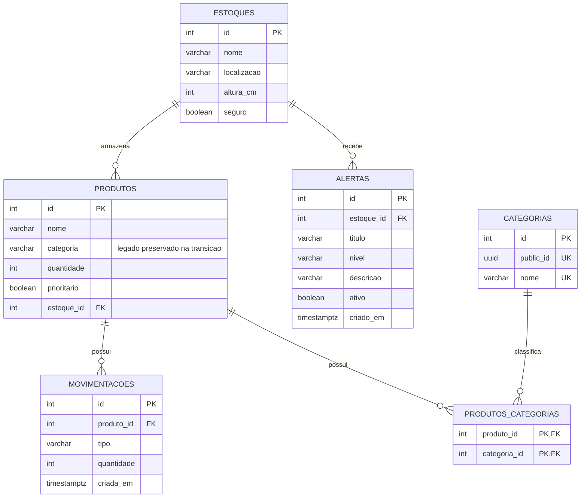

# Modelo de dados do Estoque Seguro

Equipe: Caio Pedrosa, David Henrique, Alberto e Rildo Neto.

Data: 6 de novembro de 2026.

## 1 Diagnóstico e relação com as funcionalidades

O projeto controla produtos, locais de armazenamento, entradas, saídas e alertas informados manualmente. O modelo inicial tinha quatro entidades persistentes. A classificação do produto era somente um texto, sem cadastro compartilhado nem possibilidade de representar várias categorias por produto.

O modelo revisado mantém essas quatro entidades e acrescenta Categoria. A relação entre Produto e Categoria é N-N: por exemplo, o mesmo produto pode ser classificado como alimentos e perecíveis, e cada classificação pode ser utilizada por vários produtos. A ligação não possui dados próprios; por isso, utiliza uma tabela intermediária, sem uma sexta classe de entidade.

| Entidade | Funcionalidade atendida |
| --- | --- |
| Estoque | Identificar o local físico e sua classificação de segurança |
| Produto | Cadastrar mercadorias e consultar a quantidade disponível no local |
| Movimentacao | Registrar entradas e saídas e manter o saldo consistente |
| Alerta | Identificar produtos com saldo em um local vulnerável sob alerta |
| Categoria | Compartilhar classificações entre produtos e permitir múltiplas classificações |

Cada produto continua pertencendo a um único estoque. A quantidade começa em zero e é alterada pelas movimentações. O cadastro de categorias não altera o saldo. As regras são vinculadas às funcionalidades do MVP descritas em `docs/Canvas.md`.

## 2 Diagrama ER do modelo revisado

A tabela `produtos_categorias` representa a N-N entre Produto e Categoria. Sua chave primária é o par `(produto_id, categoria_id)`. O `JoinTable` fica somente em Produto; Categoria declara o lado inverso. Os tipos das relações usam `Relation` no TypeScript.

## 3 Antes e depois

| Antes | Modelo revisado | Motivo |
| --- | --- | --- |
| Quatro entidades | Cinco entidades | Representar a classificação como parte do domínio |
| Categoria apenas como texto do produto | Categoria como entidade e relação N-N | Compartilhar classificações e permitir mais de uma por produto |
| Sem identificador público de categoria | `public_id` UUID único e gerado no banco | Disponibilizar um identificador público sem substituir as chaves internas existentes |
| Possibilidade de categorias com nome igual | Nome de categoria único | Evitar duplicação do mesmo nome cadastrado |
| Sem tabela de ligação | `produtos_categorias` com chave composta | Impedir a repetição do mesmo vínculo |

O texto antigo `Produto.categoria` permanece durante a transição para preservar os registros existentes. O preenchimento das novas categorias e dos vínculos deve ser feito por migração de dados, antes de considerar a retirada desse campo. A política de normalização dos nomes deve ser a mesma na migração e nas novas entradas da aplicação.

## 4 Chaves estrangeiras e exclusão

| Tabela e coluna de origem | Referência | onDelete | Justificativa de negócio |
| --- | --- | --- | --- |
| `produtos.estoque_id` | `estoques.id` | RESTRICT | Excluir um local não deve apagar seus produtos |
| `movimentacoes.produto_id` | `produtos.id` | RESTRICT | O histórico deve continuar identificando o produto movimentado |
| `alertas.estoque_id` | `estoques.id` | RESTRICT | O registro de alerta deve preservar a identificação do local |
| `produtos_categorias.produto_id` | `produtos.id` | CASCADE | Um vínculo de classificação não faz sentido depois da exclusão permitida do produto |
| `produtos_categorias.categoria_id` | `categorias.id` | RESTRICT | Uma categoria utilizada exige reclassificação antes de ser excluída |

O CASCADE da tabela intermediária remove somente vínculos. Ele não apaga categorias nem movimentações. As regras existentes de saldo e histórico continuam limitando a exclusão de produtos.

## 5 Colunas nulabilidade e tipos

As colunas declaradas atualmente nas cinco entidades são obrigatórias, salvo mudanças transitórias explicitadas nas novas migrações. As FKs das relações obrigatórias não aceitam NULL. O código TypeScript deve acompanhar a nulabilidade que efetivamente existir no banco.

| Grupo de campos | Decisão |
| --- | --- |
| Chaves internas | Inteiros gerados; preservados para manter as referências existentes |
| Categoria pública | UUID `public_id`, único, com geração por `gen_random_uuid()` |
| Nomes e descrições | VARCHAR com limites explícitos e validação de texto |
| Quantidades e altura | Inteiros; quantidades fracionárias não fazem parte desta versão |
| Indicadores | Booleanos para seguro, prioritario e ativo |
| Instantes de registro | TIMESTAMPTZ em movimentações e alertas |
| Tipo de movimentação | Enum TypeScript ENTRADA/SAIDA, protegido no banco por VARCHAR com CHECK |
| Nível do alerta | Enum TypeScript BAIXO/MEDIO/ALTO, protegido no banco por VARCHAR com CHECK |

O UUID de Categoria não significa que todas as rotas antigas foram convertidas: os recursos anteriores ainda possuem contratos com IDs numéricos. Essa compatibilidade precisa ser considerada na evolução da API.

## 6 Restrições de integridade e índices

| Restrição | Regra protegida |
| --- | --- |
| UNIQUE em `categorias.nome` | Recusar nomes cadastrados exatamente iguais |
| UNIQUE em `categorias.public_id` | Impedir repetição do identificador público |
| PK composta da ligação | Impedir repetir o mesmo produto na mesma categoria |
| CHECK de quantidade do produto maior ou igual a zero | Impedir saldo negativo no banco |
| CHECK de quantidade da movimentação maior que zero | Impedir movimentação sem quantidade positiva |
| CHECK de altura maior ou igual a zero | Recusar altura negativa |
| CHECKs dos valores de tipo e nível | Impedir situações fora dos conjuntos definidos |
| CHECKs de textos não vazios da migração inicial | Impedir registros com os campos protegidos vazios ou só com espaços |

O UNIQUE do nome diferencia maiúsculas e minúsculas no formato atual. A normalização das entradas precisa ser definida e aplicada de modo consistente; a restrição não deve ser apresentada como se já fosse insensível a caixa.

Os índices existentes `idx_produtos_estoque`, `idx_movimentacoes_produto` e `idx_alertas_estoque` apoiam buscas por local e por produto. A ligação N-N usa chave composta e índices dos vínculos conforme sua definição TypeORM. O SQL das novas migrações deve ser conferido para preservar os índices e CHECKs já existentes. Não se presume que toda FK no PostgreSQL receba índice automaticamente.

## 7 Verificação da Atividade 2

Esta seção deve ser preenchida com as execuções reais da versão final. Os resultados da entrega anterior não comprovam as alterações novas.

| Verificação | Evidência a registrar |
| --- | --- |
| Banco vazio | Comando e saída de migration:run, versão testada e migrações aplicadas |
| Esquema coerente | Saída de migration:check |
| Preservação | Comparação de registros, saldos, históricos e classificações antes/depois |
| Reversão | Saída de migration:revert e reaplicação em banco descartável |
| Seed | Comando, dados criados e cobertura das relações 1-N e N-N |
| Listagem | Requisição paginada e resposta com estoque e categorias |
| Quantidade de consultas | Log SQL de páginas com tamanhos diferentes e contagem real |
| Restrição | Comando ou curl, resposta HTTP e estado do banco após a recusa |
| Testes | Comando, resultado, responsável, data e commit testado |

Até que essas evidências sejam acrescentadas, esta seção não representa uma validação concluída da Atividade 2.

## 8 Referências

- [Canvas do projeto](Canvas.md)
- [M04 Entidades TypeORM](https://github.com/heliobentzen/dpw/blob/main/modulos/04-entidades-typeorm/README.md)
- [M05 Migrações](https://github.com/heliobentzen/dpw/blob/main/modulos/05-migracoes/README.md)
- [M06 Consultas](https://github.com/heliobentzen/dpw/blob/main/modulos/06-orm-consultas-crud/README.md)
